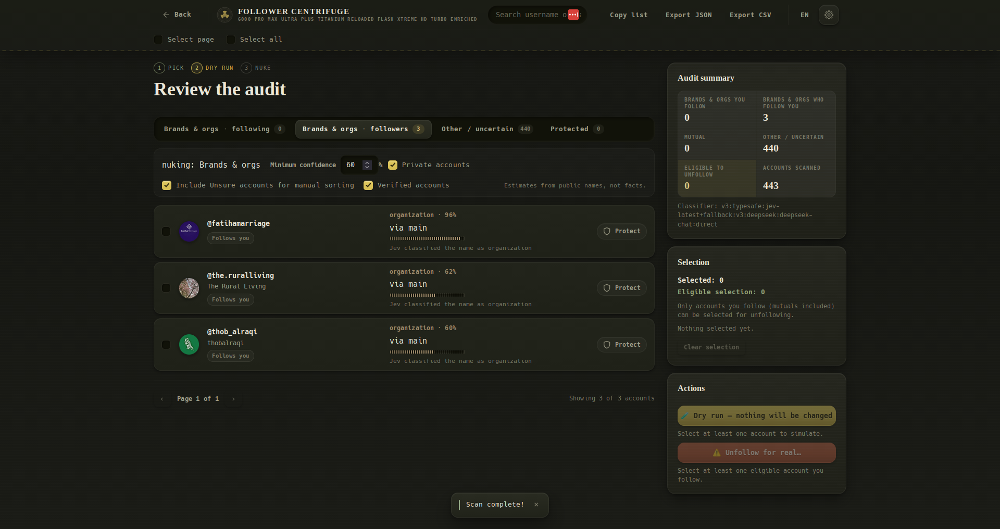

# ☢️ Follower Centrifuge 6000 Pro Max Ultra Plus Titanium Reloaded Flash Xtreme HD Turbo Enriched

An Instagram **list-curation tool** that runs as a browser console script. It scans **both** the accounts you follow and the accounts that follow you, classifies each account into a category from its public details (username, display name, and optionally its public profile photo), and lets you review the result before unfollowing anything — with **dry runs always first** and live unfollows gated behind an explicit typed approval.

The default category set is broad and balanced — **Female, Male, Bots & AI, Brands & orgs, Unsure** — and the wizard asks which category you want to remove. Nothing in the product is specific to one category: the same flow, safety gates and review tools apply to whichever category (or categories, by repeated runs) you pick.

> **Live page:** <https://faissaloo.github.io/follower-centrifuge/> · **Repo:** <https://github.com/faissaloo/follower-centrifuge>
>
> **Fork of [davidarroyo1234/InstagramUnfollowers](https://github.com/davidarroyo1234/InstagramUnfollowers) (MIT).** The original tool finds accounts that don't follow you back. This fork repurposes the same Instagram private-API client for category-based account curation, swaps the classifier to TypeSafe AI's *Jev* model (DeepSeek as fallback, plus an optional vision pass for profile photos), and adds a safety-first review/approval workflow.

<u>Runs in your browser. No downloads, no backend account access, no credentials leave your machine except the public names sent to the classifier you configure.</u>

## 📸 Review screen



The review is where the tool earns its keep: target tabs (including the **followers** side), an **Include Unsure accounts for manual sorting** option, a free **0–100% confidence number box**, per-row **via main / via fallback** provenance, and a dry-run action that changes nothing until you explicitly choose a live run.

---

## ✨ What it does

0. **Checks the relay first.** On instagram.com the launch screen verifies that the local relay is actually reachable (and, in Firefox, that the local CA is trusted) before any category can be picked. If it is down, the screen explains how to start it (`npm run proxy`), how to retry, and how to fix Firefox trust.
1. **Asks what to nuke.** A three-step wizard starts with one question — which category do you want out of your lists: **Female, Male, Bots & AI, Brands & orgs, or Unsure?** — then scans and offers a dry run. The list of categories is a neutral default set, not a product focus: the same pipeline handles any category you pick. Advanced configuration (classifier keys, pacing, protection list) lives behind a quiet **Advanced** link and is only needed once in a while.
2. **Scans two lists** with the Instagram session already open in the tab:
   - everyone **you follow** — these accounts can be unfollowed, and
   - everyone **who follows you** — followers-only accounts can be removed from your followers list; mutual accounts are handled from the following side.
3. **Merges them** into one audited list with `You follow` / `Follows you` / `Mutual` badges. Live runs show a **cooldown countdown** during deliberate pacing pauses and an **estimated time to completion**, so long 5-minute safety pauses don’t look like a frozen tab.
4. **Reuses fresh lists.** After a completed scan, the raw following/followers lists are cached for **30 minutes**. A repeat scan (for example, choosing a different category) replays the cached lists instead of paginating Instagram again; classification results are reused too unless the classifier prompt/model settings changed. Changing only the target category is just a local re-filter. A live run interleaves unfollows and follower removals instead of exhausting one queue first, then invalidates the cache, and cached lists carry their original fetch time so stale lists cannot loosen the live-action freshness gates.
5. **Classifies accounts** into one of five default categories — `female`, `male`, `machine` (bots/AI feeds), `organization` (brands/media/teams) and `ambiguous` — with a confidence score and reason. It uses **usernames, display names and (when enabled) public profile photos**: a vision model turns photos into neutral visual cues, and **TypeSafe Jev remains the main category decision-maker**, with DeepSeek as the fallback. Profile photos are downscaled to small thumbnails before leaving the browser, and vision requests are chunked; transient classifier failures are retried once. Each review row is labelled **via main** or **via fallback** so you can see which classifier produced the guess. Photo cues are explicitly weighted as strong evidence by the Jev prompt, not just attached as decoration.

   The primary classifier is **TypeSafe AI Jev** (`jev-latest`), which is fast and cheap; **DeepSeek** is the fallback when Jev fails and can be configured for the local proxy or direct browser mode. Results are cached, batched, retried and strictly validated.
6. **Dry run first, then confirm.** The wizard runs a clearly-labelled dry run that changes nothing; only after reviewing it can you promote the exact same list to a live "nuke" with the typed approval. Categories other than the chosen one stay in **Other / uncertain**. Ambiguous guesses can be shown as manually selectable by default (`Include Unsure accounts for manual sorting`) so you can review and pick them yourself; the choice still goes through the same dry-run and typed live approval. The confidence floor is a free **0–100% number box**, not a dropdown, so you can deliberately go below 50% when widening the net. The dry-run executor has no unfollow transport, so it makes **zero** Instagram write requests; live requires a typed `UNFOLLOW <n>` phrase plus an "I understand" checkbox.
7. **Protects you.** Whitelist (matched by account id **and** username), eligibility checks, incomplete-scan locks, per-account pacing, a still-followed preflight before every write, mid-run whitelist enforcement, and an automatic stop on Instagram action blocks (`feedback_required` / 429).
8. **Nuclear, but tasteful.** The interface is a restrained atomic-age test instrument with a live gas-centrifuge enrichment animation (counter-rotating rotors + cascade bars, reduced-motion aware): charcoal ground, uranium amber, olive, dosimeter green, engraved trefoil seal, tactile nu-skeuomorphic panels and hazard-stripe accents (no neon, no glows).

---

## 🔒 Safety model

| Guarantee | How it is enforced |
| --- | --- |
| Dry runs never write to Instagram | Dry-run and live actions are different TypeScript types (`DryRunPlan` vs `LivePlan`); the dry-run executor never receives the unfollow transport or timers. Tests spy-assert zero transport/network calls. |
| Live needs explicit approval | A `LivePlan` only exists with the exact phrase `UNFOLLOW <count>` typed in a modal behind an "I understand" checkbox. The executor re-validates the approval, and the plan is bound to the exact account ids the dialog displayed. |
| Actions match the connection direction | Following/mutual accounts are unfollowed (with an `isStillFollowing` preflight); followers-only accounts are removed from your followers list (with an `isStillFollower` preflight). Both fail closed before writing. Follower removal mirrors instagram.com's own `remove_follower` request (endpoint target id, `fb_dtsg`/`jazoest` body, web-app headers) and only counts `{"status":"ok"}` as success. |
| Whitelisted accounts are untouchable | Protection matches account id **and** normalized username (so bulk-pasted/imported entries protect the real account). Checked at display, plan build, and again immediately before every live write — including accounts protected *during* a running queue. |
| No action on incomplete scans | Truncated pagination / failed lists mark the review incomplete and hard-lock live unfollowing. |
| No stale or cross-account actions | Cached reviews are viewer-scoped (stored `ds_user_id` must match), expire after 24 h, cannot drive live actions, and a live run requires the same viewer and a review younger than 30 minutes. |
| No accidental real-account runs | Localhost is a fully synthetic offline demo with live unfollowing disabled; tests globally block `fetch`/XHR/WebSocket/EventSource/sendBeacon; a second independent review pass audited the destructive paths. |
| Guesses are estimates | Every row shows a category, confidence, reason and classifier provenance. `ambiguous` accounts are separated; they are only removable through the explicit **Include Unsure accounts for manual sorting** option, and still go through dry run + typed live approval. |

---

## 🚀 Using it

### 1. Build or obtain the script

Requires Node 22.

**Important: on instagram.com the classifier needs the bundled local relay.**
Instagram's page Content-Security-Policy blocks direct `fetch` calls to the
classifier APIs, but allows `ws://localhost:*`. The proxy therefore also serves a
WebSocket relay; start it once in a terminal and keep it running while you scan:

```bash
npm ci
DEEPSEEK_API_KEY=... npm run proxy    # key optional: the browser can send its own
```

The relay forwards only `api.typesafe.ai` / `api.deepseek.com`, only over HTTPS,
and only accepts `instagram.com` or localhost as the browser origin. It is
loopback-only — never expose it.

**Firefox one-time step:** Instagram's CSP sends `upgrade-insecure-requests`, which
upgrades `ws://localhost` to `wss://localhost`; the script then uses the secure
relay on `wss://localhost:8788`. The proxy generates a **local CA** and, on start,
installs it as a trusted CA into every Firefox profile's NSS database (and
Chrome's `~/.pki/nssdb`) using `certutil` — the same approach as mkcert. No
"Accept the Risk" dialog is involved; just **restart Firefox once** so it reloads
the trust store. Manual re-install: `npm run trust:relay` (it auto-downloads
`libnss3-tools` into the gitignored `.tools/` when needed). Chrome/Edge use the
plain `ws://localhost:8787` relay automatically.

```bash
npm run build          # public build: embeds the app into public/index.html (NO API keys)
```

Open `public/index.html` from the repo (or the GitHub Pages deployment at <https://faissaloo.github.io/follower-centrifuge/>) and press **COPY** in the page. This public script contains **no credentials**: if it has no baked-in API keys, the wizard asks for them on first run and keeps them only in that tab's `sessionStorage` (they can also be entered later in Settings).

**Optional personal keyed build** (no proxy, no setup when pasting — for your own use only):

```bash
# put keys in gitignored files (or export the env vars)
printf '%s' 'apikey_…' > .typesafe-key      # TypeSafe Jev (primary)
printf '%s' 'sk-…'     > .deepseek-key      # DeepSeek (fallback, optional)
npm run build:local-key                     # -> dist/critical-relations-local.js (gitignored)
```

The keyed file has the keys compiled in and defaults to TypeSafe Jev with DeepSeek fallback. **Never commit, publish or share it** — regenerate it with `npm run build:local-key`, and rotate the keys if it may have leaked. `public/index.html`, `dist/dist.js` and every normal build never embed a key: the embed is gated behind the `IU_ALLOW_EMBEDDED_KEY` flag that only `build:local-key` sets.

### 2. Configure the classifier (public/GitHub Pages script)

In the wizard's **set up the classifier** panel (or later in **Settings → Name classifier**):

- **Primary provider**: TypeSafe Jev (recommended). Paste a TypeSafe API key into the TypeSafe section; the default model is `jev-latest` and the base URL is `https://api.typesafe.ai`. Keys stay in this tab's `sessionStorage` and are never written to `localStorage`.
- Optionally keep **“Fall back to DeepSeek if Jev fails”** enabled and configure the DeepSeek section (proxy URL, or direct mode + key).
- **Test connection** probes the primary provider and reports whether the DeepSeek fallback is ready.
- **Offline demo** needs no key and makes no network calls.

### 3. Run it on Instagram

0. Start the local relay first: `npm run proxy` (keep it running).
1. Copy the script (public COPY page or the keyed file) and paste it into the DevTools console on a logged-in [instagram.com](https://www.instagram.com) tab, then press Enter.
2. Pick the category you want to nuke (**Female, Male, Bots & AI, Brands & orgs, Unsure**). The wizard scans both lists automatically, classifying accounts as they load. New page data is sliced into small immediate chunks and **two classifier batches are kept in flight at once**, so the DeepSeek photo pass and the Jev text pass overlap with each other and with pagination instead of waiting for a complete list.
3. Review the matching accounts, protect anyone important, and select candidates.
4. Press the dry-run button and inspect the simulation — nothing changes.
5. If it looks right, press **Nuke these for real…**, tick the acknowledgement and type the exact confirmation phrase.
6. Advanced setup (classifier key/model/fallback, pacing, protected list) is behind the quiet **Advanced** link — most runs never need it.

### 4. Local demo (no account needed)

```bash
npm run build-dev
```

Open `http://localhost:8080/?preview=review`, press **COPY**, and paste the script into the console on that page. On localhost the app runs in fully offline demo mode with synthetic accounts; live unfollowing is disabled.

---

## 🧪 Verification & tests

```bash
npm test                 # 859 tests / 51 files (unit, component, integration, safety)
npm run test:coverage    # coverage thresholds
npm run verify           # typecheck app + tests, lint, tests
npm run check:classifier # MANUAL real-API check (synthetic names only; uses .typesafe-key/.deepseek-key)
```

- The automated suite **never touches Instagram or the real classifier APIs**: network guards block all browser egress, providers are exercised with injected fakes, and the full provider chain is tested over loopback against fake Jev/DeepSeek upstreams.
- `npm run check:classifier` is the deliberate exception: it reads your gitignored keys and runs the real classifier prompt end-to-end with synthetic names. It verifies the five-category output and both providers.
- CI (`.github/workflows/tests.yaml`) runs typechecks, lint, tests and a production bundle on every push/PR.

---

## 🏗️ Architecture

```
src/
  model/                 # contracts (categories/target, audit, plans, provider config)
  utils/
    friendships-list.ts  # paginated Instagram list walker (retries/backoff/abort)
    account-audit.ts       # scan both lists, merge relationships, stream-classify
    typesafe-client.ts   # TypeSafe Jev System One client (choice questions, retries, timeouts)
    gender-classifier.ts # provider router: Jev main -> DeepSeek fallback; vision photo cues; cache+prompt+parser
    deepseek-client.ts   # OpenAI-compatible chat client (proxy/direct)
    gender-cache.ts      # versioned local guess cache
    action-plan.ts       # selection -> plan (eligibility + approval phrase)
    unfollow-executor.ts # dry-run vs live executors (separate paths)
    approval.ts          # shared live-confirmation helpers
    audit-display.ts     # target tabs / other / search / pagination / summary
    whitelist-match.ts   # id + username protection matching
    review-cache.ts      # viewer-scoped, expiring review cache
    deepseek-settings.ts # provider/keys persistence (session-only; embedded-key merge)
    audit-preferences.ts # persisted category preference
    i18n.ts              # EN/ES
  components/
    NukeWizard.tsx       # wizard step 1: pick the category to nuke
    WizardSteps.tsx      # pick -> dry run -> nuke step indicator
    Centrifuge.tsx       # decorative enrichment-cascade animation
  preview/demo-data.ts   # synthetic offline dataset
  App.tsx / main.tsx     # wiring + bootstrap
server/deepseek-proxy.mjs # optional local DeepSeek proxy (zero dependencies)
docs/classifier-setup.md  # provider setup, keys, privacy, cost, troubleshooting
tests/                    # automated tests (network-free)
```

---

## ⚠️ Known limitations & responsible use

- **Category inference is probabilistic.** Names and photos can be ambiguous, outdated or deliberately misleading; uncertain results land in *Other / uncertain* and are never eligible. Treat the output as a review aid, not ground truth.
- **Profile photos are optional but sensitive.** When enabled, public profile photo URLs are sent to the DeepSeek vision model so it can produce neutral visual cues; usernames and display names are always included. You can disable the photo pass in **Advanced** to keep the classifier text-only. Photos are never stored locally beyond the existing review cache.
- **Automated tests never call the real APIs**, so a future API change by TypeSafe/DeepSeek/Instagram cannot be caught in CI. Do the first real-world run as a dry run on a small selection.
- **Classifier keys are sensitive.** Public/GitHub Pages users bring their own keys (sessionStorage only). The optional keyed local build stores keys in the compiled file — never publish it, and rotate keys if it may have leaked.
- **A local relay is required on instagram.com.** Instagram's page CSP (`connect-src`) blocks direct API requests to both classifier providers, but allows `ws://localhost:*`; `npm run proxy` serves that relay (plain ws for Chrome/Edge, secure wss for Firefox, which upgrades ws because of `upgrade-insecure-requests`). It is loopback-only, allowlists only the two classifier hosts, and only accepts Instagram/localhost browser origins. Never expose it publicly. The local CA is installed automatically by `npm run proxy`; restart Firefox once
after installing. `npm run trust:relay` re-installs it manually (e.g. after a new
profile is created). Without the relay, the review shows an actionable “classifier couldnt reach the provider” banner instead of silently leaving accounts unclassified.
- **Cancelling a scan stops between batches**; an in-flight request is allowed to finish (all requests are timeout-bounded). Partial results are kept for an incomplete review where live unfollowing is locked.
- **Live actions are your responsibility.** Only act on accounts you have reviewed; automate at your own risk and respect Instagram's Terms of Use. This tool is not affiliated with Instagram, TypeSafe AI or DeepSeek.

## 📄 License

MIT, same as the original [InstagramUnfollowers](https://github.com/davidarroyo1234/InstagramUnfollowers) project. See [LICENSE](LICENSE).
